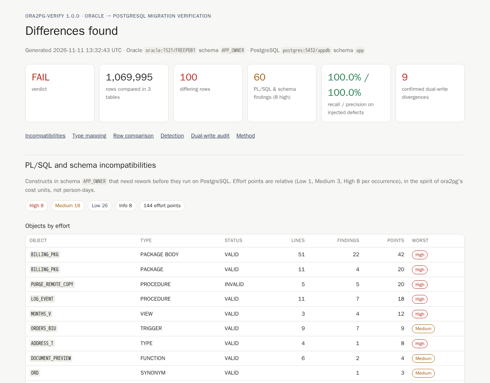
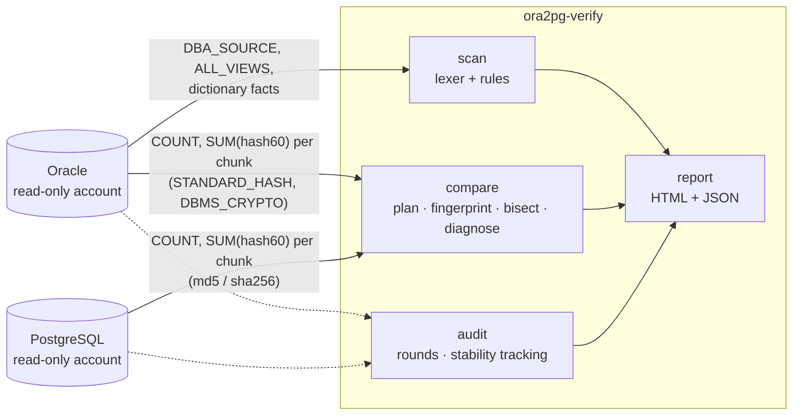
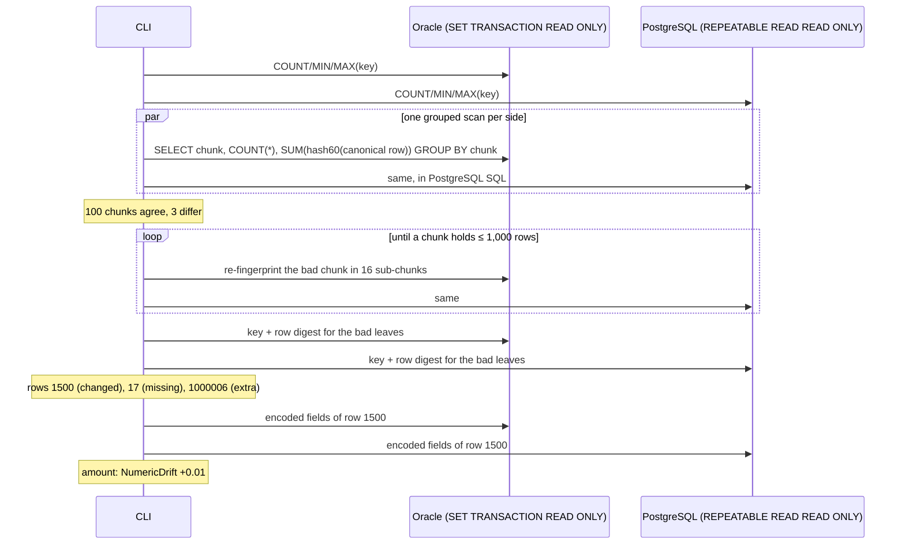

# ora2pg-verify

[](https://github.com/hekimcan206/ora2pg-verify/actions/workflows/ci.yml)
[](https://github.com/hekimcan206/ora2pg-verify/actions/workflows/codeql.yml)
[](LICENSE)
[](global.json)

**Verify an Oracle → PostgreSQL migration before you sign it off.** A .NET 10 CLI that:

1. **scans PL/SQL and the Oracle dictionary** for constructs that need rework in PostgreSQL, such as CONNECT BY,
   ROWNUM, DECODE, `(+)` joins, package state, autonomous transactions, `DBMS_*`, SYSDATE semantics and the
   `''` = NULL rule, with a severity and a suggested rewrite for each;
2. **compares table contents with chunked checksums computed inside both databases**, then drills down to the
   exact differing rows, the differing columns and the reason (empty string vs NULL, time of day lost, time
   zone shift, rounding, …);
3. **audits a dual-write cut-over**, telling real divergence apart from replication lag while both databases
   are being written.

Everything lands in one self-contained HTML report (plus JSON for pipelines).

> All data in this repository is synthetic; no real personal, customer or production data is used anywhere.



## The problem

"Row counts match" is how most migrations are signed off. It misses every changed value, and a lost row plus a
duplicated row cancel out. The failures that actually happen in Oracle → PostgreSQL migrations are semantic:

- Oracle cannot store `''` (it is NULL). PostgreSQL can, and `WHERE note IS NULL` quietly stops matching.
- Oracle `DATE` has a time of day. Map it to PostgreSQL `date` and every time is gone.
- `NUMBER` mapped to `double precision` loses digits past the 15th.
- `TIMESTAMP WITH TIME ZONE` loaded with the wrong session zone shifts by hours.
- `CHAR` padding, trailing spaces in `VARCHAR2`, case folding, edited CLOBs.

A useful verifier has to catch all of these on a million rows, **name the exact rows**, **not raise false
alarms** on representation differences that do not change meaning (padding not stored, offsets normalised,
`12.50` vs `12.5`), and do it with read-only accounts and without copying the tables.

## How it works





## Why this design

- **Compute in the database, transfer fingerprints** ([ADR 0001](docs/adr/0001-chunked-checksums-with-pushdown-and-bisection.md)).
  Each side returns `COUNT(*)` and `SUM` of a 60-bit row hash per chunk in **one grouped scan**. Mismatched
  integer-key chunks are split 16 ways until they hold ≤ 1,000 rows (data-diff's bisection). Text and
  composite keys use **hash buckets**, because range boundaries depend on collation and Oracle and PostgreSQL
  sort text differently. AWS DMS-style streaming of every row is kept as the client-side baseline and
  cross-check.
- **One canonical encoding, three implementations, proven equal** ([ADR 0002](docs/adr/0002-canonical-encoding-and-type-semantics.md)).
  Fields are `~` or `<UTF-8 bytes>:<text>`: injective, NULL ≠ `''`. Numbers lose trailing zeros, DATE is
  rendered to the second, TIMESTAMP WITH TIME ZONE as the UTC instant, CHAR with Oracle's blank-padded rule,
  CLOB as a digest. Oracle's `STANDARD_HASH` refuses LOBs (ORA-00902), so CLOBs go through `DBMS_CRYPTO`,
  verified byte-equal to PostgreSQL `md5(text)`. An integration test inserts 300 rows of awkward values into
  both engines and checks that Oracle SQL, PostgreSQL SQL and C# agree on **every field**.
- **Dual-write audit by stable divergence** ([ADR 0003](docs/adr/0003-dual-write-audit-by-stable-divergence.md)).
  Two engines cannot be read at one instant. A row is confirmed only when the same pair of digests is seen in
  three consecutive rounds; rows that converge are lag; rows still moving are not judged yet.
- **A scanner that complements ora2pg instead of wrapping it** ([ADR 0004](docs/adr/0004-plsql-scanner-own-lexer-and-token-rules.md)).
  A small lexer keeps comments and literals from producing findings; token rules name the construct, the
  severity and the usual rewrite; dictionary facts add sequences beyond bigint, synonyms, links, temporary
  tables and risky types.
- **Least privilege and data minimisation** ([threat model](docs/threat-model.md)). Read-only accounts, a
  read-only snapshot transaction, credentials only from environment variables, and no row values in the
  report unless you ask for them.

## Quick start

### Docker (zero manual steps)

```bash
docker compose up        # Oracle 23ai Free + PostgreSQL 17, seed, scan, compare, audit
# then open http://localhost:18090/report.html
```

`DEMO_ROWS=1000000 docker compose up` runs the benchmark-size dataset (default 200,000 orders). Real output of the
1 M-row run:

```text
schema created (1445 ms); loading 1,000,000 orders, 50,000 customers, 20,000 documents, 20,000 accounts on both engines
loaded: Oracle 102.7 s, PostgreSQL 8.5 s
injected 100 defects (10 kinds)
scan: 8 stored objects from DBA_SOURCE, 60 findings in 535 ms
planned 3 table(s): orders (Range), customers (HashBucket), order_documents (HashBucket)
orders              999,995 /    999,995 rows  missing   10  extra   10  changed   50      8,775 ms (DatabaseSide, Range)
customers            50,000 /     49,990 rows  missing   10  extra    0  changed   10        499 ms (DatabaseSide, HashBucket)
order_documents      20,000 /     20,000 rows  missing    0  extra    0  changed   10      1,246 ms (DatabaseSide, HashBucket)
detection: recall 100.0 %, precision 100.0 %, 100/100 injected defects found at the exact row, 0 false positives
planned 1 table(s): accounts (Range)
dual-write: 100 writes/s for 20 s, PostgreSQL lag up to 500 ms, 3 faults per kind
dual-write audit: 2000 writes, 9 faults, 9 confirmed (TP 9, FP 0), 434 transient differences
dual-write: 9/9 faults confirmed, 0 false positives, 434 transient differences ignored
DEMO_OK report written
```

### Against your own databases

```bash
export ORA2PGV_ORACLE="Data Source=dbhost:1521/ORCLPDB1;User Id=verify_reader;Password=..."
export ORA2PGV_POSTGRES="Host=pghost;Database=app;Username=verify_reader;Password=..."

ora2pg-verify scan    --oracle-schema APP --html scan.html
ora2pg-verify compare --oracle-schema APP --postgres-schema app --scan --html report.html --json report.json
#   --tables orders customers   --chunk-rows 10000   --strategy db|client   --hash md5|sha256
#   --empty-as-null             --include-values (puts row values in the report: off by default)
```

`compare` exits **0** when every row matches, **1** when there are differences and **2** on usage errors, so it can
gate a pipeline. The accounts need only `SELECT` on the tables. The Oracle account also needs
`SELECT_CATALOG_ROLE` for the scan (otherwise it falls back to `ALL_SOURCE` and says so) and
`EXECUTE ON DBMS_CRYPTO` for CLOB columns ([deploy/oracle/init/01-users.sh](deploy/oracle/init/01-users.sh)).

## Results (measured)

1 M-row synthetic schema, i7-13620H laptop, Oracle 23ai Free and PostgreSQL 17 in Docker, CLI on the host.
Medians after a warm-up run. Method, environment, host load and raw numbers are in [docs/benchmarks.md](docs/benchmarks.md).

| What | Result |
|---|---|
| **Detection**, 100 injected defects of 10 kinds in 1,069,995 rows | **recall 100 % (100/100), precision 100 % (0 false positives)**; exact column 100/100, diagnosis 100/100 (empty string vs NULL, time of day lost, +3 h shift, +0.01 drift, trailing space, case only, CLOB edit, missing, extra) |
| `orders`, 1 M rows, database-side, 1,000-row chunks (default) | **6.5 s** median, **12,276 rows transferred** |
| `orders`, database-side, 10,000-row chunks | 9.0 s, 83,068 rows transferred |
| `orders`, client-side (stream and hash every row in .NET) | 13.8 s, **2,000,092 rows transferred** |
| Where the time goes (1,000-row chunks) | Oracle busy 6.5 s, PostgreSQL 3.1 s: Oracle Free (2 CPU threads) hashing 1 M rows is the critical path |
| Chunk size, `orders` (median of 3) | 500 rows 5.6 s · 1 k 6.5 s · 2 k 6.6 s · 5 k 6.8 s · 10 k 8.2 s · 100 k 12.4 s · 1 M 16.5 s. Large chunks pay in drill-down (11.4 s of 16.5 s at 1 M) |
| Hash buckets, `customers` (50 k rows, text key, 20 defects) | 100-row buckets 0.28 s / 4,646 rows transferred vs 10 k-row buckets 0.46 s / 100,022 |
| CLOBs, `order_documents` (20 k × 1–6 KB) | database-side 1.6 s vs client-side 3.0 s |
| SHA-256 instead of MD5 (10 k chunks) | 9.9 s vs 9.0 s (+10 %) |
| **Dual-write audit**: 2,000 writes at 100/s, PostgreSQL lag up to 500 ms, 9 injected faults | **9/9 confirmed, 0 false positives**, 434 lagging writes correctly ignored; median time to confirm **3.0 s** (max 3.8 s); one audit round over 20 k rows 127 ms |
| PL/SQL scan of the sample schema | 60 findings (8 high) in 47 ms median |

On localhost the network is nearly free, so pushdown wins on wall time by about 2× and on transfer by **160×**.
Over a WAN link the 2 M streamed rows would dominate. The chunk-size sweep is why the default is 1,000 rows.

## Tests

**106 tests**, all passing locally and in CI:

- **94 unit tests** (no database), including:
  - **13 FsCheck properties**: the encoding is injective; scale and CHAR padding never matter; an instant
    encodes the same in any offset; and, the core guarantee, for *any* set of deletions, insertions and changes
    and *any* chunk/leaf/bisection setting, the comparison reports exactly the mutated rows, with both
    strategies agreeing. These run on in-memory sources that compute exactly what the SQL computes.
  - **4 golden files**: the generated pushdown SQL for both engines, the PL/SQL scan of the sample schema, and
    the HTML report.
- **12 Testcontainers integration tests** on `gvenzl/oracle-free:23-slim-faststart` and `postgres:17-alpine`,
  initialised with the compose scripts and run serially:
  - three-way canonical parity on 300 rows of awkward values;
  - 100 % recall and precision with exact rows, columns and diagnosis;
  - strategy and hash agreement, and the empty-as-NULL policy;
  - the dictionary scan against the offline scan;
  - reader accounts that cannot write, and one snapshot per comparison;
  - the dual-write audit;
  - reports that contain no credentials.

```bash
dotnet test                       # everything (Docker needed for the integration project)
dotnet test --project tests/Ora2PgVerify.UnitTests
```

## Limitations and next steps

- **Types not compared:** `BLOB`, `RAW`, `LONG`, `BFILE`, `XMLTYPE`, `INTERVAL`, `BINARY_FLOAT/DOUBLE` are
  reported as `TYPE_NOT_COMPARED` and excluded. They do not silently pass. NCLOB/NVARCHAR2 in a non-AL32UTF8
  national character set, and Oracle databases whose character set is not AL32UTF8, are not verified.
- **Single-column integer keys get range chunks and bisection; all other keys get hash buckets,** where every
  drill-down batch is a full scan. Tables without a primary key are not compared (reported).
- **Two snapshots, not one:** each side is consistent in itself, but Oracle and PostgreSQL are read at slightly
  different moments. Compare a quiesced source, or use the dual-write audit while writes continue.
- **The audit cannot judge rows written more often than its round interval** (they stay "unstable"). Lag longer
  than three rounds is reported as divergence.
- **Checksums detect accidents, not adversaries.** Someone who can write to both databases can hide a change.
  60-bit chunk sums can collide with probability about 2⁻⁶⁰ per chunk.
- **The scanner is token-based:** dynamic SQL inside string literals is not analysed, and package state is found
  heuristically (reported per line for review). It complements ora2pg's assessment rather than replacing it.
- **Scale tested:** 1 M + 50 k + 20 k rows on a laptop with Oracle Free (2 CPU threads, 2 GB). A real Oracle
  instance with parallel query would change the absolute numbers. The method has not been measured beyond that.
- **Next steps:** keyed pseudonyms for keys in the report, `PARALLEL` hints for Oracle fingerprints on Enterprise
  Edition, composite-key range chunking (tuple comparison), an incremental mode restricted to recently changed
  rows, and a GitHub Action wrapper.

## Privacy note

The tool reads production data by nature, so the report is designed to leave the perimeter safely. It holds
keys, column names, counts and the *kind* of difference, but no values, unless `--include-values` is passed for
one run. CLOBs only ever appear as digests, and string literals in PL/SQL snippets are redacted. Primary keys can
themselves be personal data (for example a national ID under KVKK, the Turkish GDPR), so treat reports as
internal documents. See [docs/threat-model.md](docs/threat-model.md).

## License

[MIT](LICENSE)
